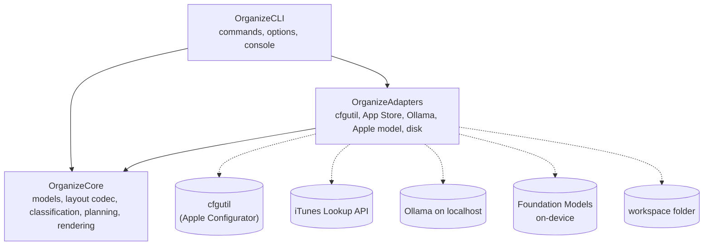
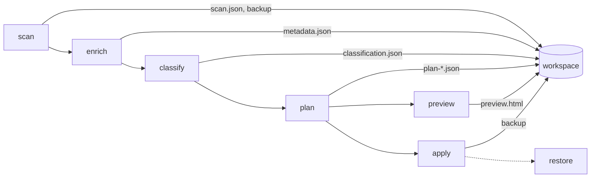
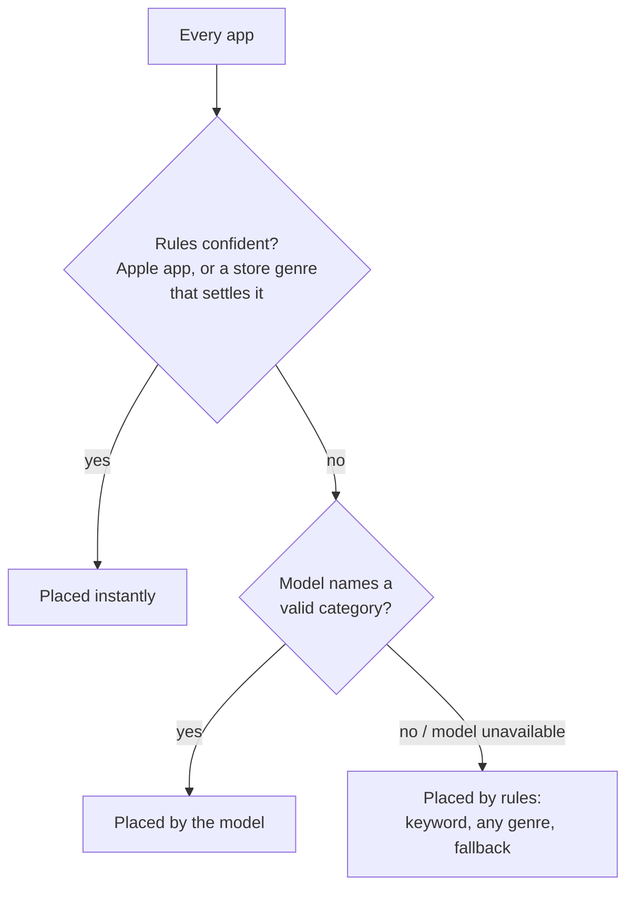

# Architecture

## Shape of the system

The package has three targets. Dependencies point one way: the CLI depends on the adapters, the adapters depend on the core, and the core depends on nothing but Foundation.



| Target | Rule | Why |
| --- | --- | --- |
| `OrganizeCore` | No I/O. No processes, network or disk. | Every decision the tool makes can be unit-tested with plain values. |
| `OrganizeAdapters` | One type per outside system, each behind a protocol. | Tests replace the outside system with a fake; a new system is a new conformance. |
| `OrganizeCLI` | Wiring and words only. | Commands stay short; nothing worth testing hides in them. |

## The pipeline



Each step reads what earlier steps saved and writes its own file, so any step can be rerun alone. `run` calls scan through preview in order. Only `apply` and `restore` write to the phone.

| Step | Core pieces | Adapter pieces |
| --- | --- | --- |
| scan | `IconLayoutCodec`, `ScanSnapshot` | `CfgutilDeviceClient`, `CfgutilParser`, `DeviceSelector`, `Workspace` |
| enrich | `AppStoreMetadata` | `AppStoreLookupClient`, `MetadataCache` |
| classify | `AppCatalog`, `Taxonomy`, `HeuristicClassifier`, `TieredClassification`, `LLMClassifier`, `ClassificationPrompt`, `ClassificationResponseParser` | `OllamaModel`, `AppleOnDeviceModel` |
| plan | `Grouping`, `CategoryPagesPlanner`, `FolderBoardPlanner`, `PlanBuilder`, `LayoutValidator` | `Workspace` |
| preview | `HTMLPreviewRenderer`, `LayoutDiff`, `PlanReport` | `Workspace` |
| apply, restore | `LayoutValidator`, `LayoutDiff` | `CfgutilDeviceClient`, `Workspace` |

## Source map

```
Sources/OrganizeCore/
  Support/         JSONValue (lossless JSON), JSONText (find JSON in noisy text), chunking
  Models/          AppRecord, AppStoreMetadata, ConnectedDevice, ScanSnapshot,
                   IconItem, IconFolder, IconLayout, GridSpec
  Layout/          IconLayoutCodec (cfgutil format), LayoutValidator, LayoutDiff
  Classification/  Taxonomy, KnownApps, AppClassifier and TextCompletionModel protocols,
                   HeuristicClassifier, TieredClassification, LLMClassifier, prompt builder and
                   reply parser, AppCatalog
  Planning/        OrganizationScheme (12 layouts), AppGroup, PlanOptions, PlanContext,
                   OrganizationPlan, LayoutPlanner, Grouping, PlanBuilder,
                   CategoryPagesPlanner, FolderBoardPlanner (Planners.swift),
                   the ten other planners (MorePlanners.swift), SectionPacker and
                   RankedPacker (Packing.swift), BucketTable (Buckets.swift),
                   RGBColor, ColorBand, DominantColor and IconColorSet (IconColor.swift),
                   SignalFiles
  Rendering/       HTMLPreviewRenderer, ColorWheelRenderer (colors.html), PlanReport,
                   ElapsedTime and StatusLine (step timers)

Sources/OrganizeAdapters/
  Device/          CommandRunning + SubprocessCommandRunner, DeviceClient, DeviceSelector,
                   CfgutilLocator, CfgutilParser, CfgutilDeviceClient
  AppStore/        HTTPClient + URLSessionHTTPClient, AppStoreLookupClient,
                   IconColorSampler + StoreIconColors (opt-in icon colors)
  Intelligence/    OllamaModel, AppleOnDeviceModel, AppleIntelligence
  Storage/         Workspace, MetadataCache

Sources/OrganizeCLI/
  OrganizeMyIPhone.swift   Root command
  Commands/                run, doctor, the five step commands, apply, restore
  Support/                 Options, Pipeline (the steps), Console, LiveStatus (live step timer)
```

## Key design decisions

### `cfgutil` is the device transport

Apple publishes no SDK for reading or arranging a connected iPhone's Home Screen. Apple Configurator's `cfgutil` is Apple's own tool, works on ordinary (unsupervised) phones, and can both read and write the layout. The alternative is the open-source SpringBoard-services route (libimobiledevice, pymobiledevice3), where writing has been unreliable since iOS 13.

Everything device-related sits behind the `DeviceClient` protocol, so a second transport can be added without touching the rest.

### The layout is modelled losslessly

`cfgutil` prints the layout as an array of arrays: the dock, then one array per page. Strings are bundle identifiers or web clip URLs. A folder is an array whose first entry is its name. `IconLayoutCodec` turns that into `IconLayout` and back.

Anything the codec does not recognize becomes `IconItem.unknown` and is written back verbatim. The tool never drops what it does not understand.

Saved layouts and backups use `cfgutil`'s own format, so a backup can be restored by hand with `cfgutil set-icon-layout`.

### Classification is tiered

A local model reads fast and writes slowly, so the design asks it for as little as possible.



1. **Rules first.** `TieredClassification.split` runs `HeuristicClassifier` over every app and keeps the results it is confident about: Apple's own apps, well-known browsers (matched by bundle identifier), and apps whose App Store genre decides the matter on its own ("Finance", "Games", "Navigation"). Catch-all genres ("Productivity", "Utilities", "Lifestyle"), keyword matches and unknown apps are left undecided.
2. **Model for the rest.** `LLMClassifier` sends only the undecided apps, in batches. `--thorough` sends every app instead.
3. **Rules fill gaps.** Whatever the model skips or answers with an unknown category falls back to the rules, so every app always gets a category.

How the model is asked matters as much as how often:

- **Thinking is switched off** (`think: false`). Ollama turns reasoning on by default for models that support it. Measured on a 35B model, each 25-app batch generated about 5,000 tokens and took about a minute. The answer itself needs an estimated 600; the rest was reasoning.
- **The reply is compact.** Apps are numbered in the prompt and the model answers `{"1":"Finance","2":"Games"}`: about 8 tokens per app instead of about 25 for a reply that repeats each bundle identifier.
- **The reply is constrained.** A JSON Schema requires one property per app number, each limited to the taxonomy's names, so a model that supports structured output cannot skip an app or invent a category.
- **Replies are never trusted.** The parser accepts several shapes, keeps only apps in the batch and categories in the taxonomy, and ignores the rest.
- **The model loads in the background.** `run` chooses the engine first and starts loading an Ollama model at once, so the load overlaps the scan and the App Store lookup instead of adding to them.

`TextCompletionModel` is the only thing a model backend has to implement: prompt in, text out. If the first batch fails, the error surfaces, because that nearly always means the model is unreachable; later failures fall back to rules for that batch. The `auto` engine prefers an Ollama model that can chat (one already in memory if there is one), then Apple's on-device model, then rules alone.

Apple's Private Cloud Compute models are not used. They need a managed entitlement that a command-line tool built with SwiftPM cannot carry, and keeping everything local is a goal.

### Planners have hard guarantees

Every `LayoutPlanner` must keep the dock unchanged and place every non-dock icon exactly once. `PlanInput` enforces the inputs (drops unknown apps, adds forgotten ones to the fallback group, collects web clips and unknown items), and `LayoutValidator` checks the output against the phone before anything is written.

The validator knows the iOS limits through `GridSpec`: 4 columns by 6 rows per page, 4 dock slots, 9 icons per folder page, 15 pages.

### Layouts that need more than a category

Some layouts need facts `cfgutil` cannot read: how much each app is used, when it was installed, and its icon color. Planners get these through `PlanContext`, which the CLI fills from optional files (`--usage`, `--recent`, `--icon-colors`) parsed by `SignalFiles`, plus a built-in color table for Apple's apps in `KnownApps.iconColors` and, when the user opts in, colors found from App Store icons. `IconColorSet` layers the three (built-in, then store, then the user's file). `IconColorSampler` (adapters) downloads the artwork and turns it into pixels; `DominantColor` (core) picks the main color by matching pixels to slices of the color wheel; `ColorWheelRenderer` writes `colors.html`, where the user corrects matches. The core never reads the files itself. When a fact is missing, the planner uses a stand-in (the current icon order for usage, the end of the layout for newest) and says so in the plan's `notes`, which the terminal summary and the preview show.

Two packers keep loose-page layouts inside the 15-page limit:

- `SectionPacker` lays out titled sections, such as categories, letters, color bands or the buckets of a `BucketTable`. When pages run out it folds the largest group into a folder, then the next largest, until the plan fits.
- `RankedPacker` lays out apps in rank order, such as by usage. When pages run out the lowest-ranked apps go into category folders on the last pages.

`BucketTable` maps the standard categories onto a layout's buckets (time of day, verbs, places, life areas). A test checks that every standard category is mapped on purpose; categories from a custom taxonomy go to each table's fallback bucket.

### The phone is only changed deliberately

`apply` rereads the phone, validates the saved plan against what is there now, shows the size of the change, saves a backup, and asks. `restore` does the same in reverse. There is no code path that writes to the phone without those steps.

### Privacy by default

The workspace defaults to `~/.organize-my-iphone`, outside any repository. The network calls are the optional App Store lookup, which sends bundle identifiers to Apple, and, only with `--icon-colors-from-store`, downloads of the icons that lookup links to, restricted to Apple's image hosts. Models run on the Mac.

## Performance budget

Targets: **scan through preview in under 2 minutes for a phone with 1,000 apps**, and **apply in under 5 minutes**.

| Step | What limits it | Design response | Estimate for 1,000 apps |
| --- | --- | --- | --- |
| Scan | Three `cfgutil` calls over USB | Nothing to tune; kept to the minimum number of calls | 5–15 s |
| App Store lookup | Network round trips; a limit of roughly 20 requests a minute | 100 identifiers per request, 4 requests at a time, results cached between runs | 3–6 s (10 requests), 0 s when cached |
| Model load | Reading a multi-gigabyte model into memory | Started in the background before the scan | 0–10 s of waiting |
| Classification | Tokens the model has to generate | Rules place the confident majority; thinking off; about 8 output tokens per app | 40–70 s for the 30–40% of apps that need the model |
| Plan and preview | Nothing | Pure in-memory work | under 1 s |
| **Total** | | | **about 1 to 1.5 minutes** |
| Apply | One `cfgutil set-icon-layout` call | Reread, validate and back up first; one write | Not yet measured |

These are estimates from one measured run, not a benchmark: a 35B model on an M4 Max generated 67–99 tokens per second and read prompts at about 1,200–1,500 tokens per second. A model's speed and the share of apps with a decisive store genre both move the classification figure. Two things can push a run past the budget:

- `--thorough` asks the model about every app. At the measured speed that is roughly 2.5 minutes of classification alone for 1,000 apps.
- A much slower model, or `--offline` on a phone with few Apple apps: with no store genres, the rules can settle little and most apps go to the model.

Ollama handles one request at a time by default (`OLLAMA_NUM_PARALLEL=1`), so batches are sent one after another. Sending several at once would help only on a server configured for parallel requests, and is not implemented.

Every step is timed on screen (see `LiveStatus`), so a run that misses the budget shows where the time went.

## Extending

| To add | Do this |
| --- | --- |
| A model backend | Conform to `TextCompletionModel` in `OrganizeAdapters/Intelligence`, and offer it in `Pipeline.chooseEngine`. |
| A classifier that is not a language model | Conform to `AppClassifier`. |
| A device transport | Conform to `DeviceClient`. |
| A layout scheme | Add a case to `OrganizationScheme` (with its `title`, `summary` and `dataNote`), write a `LayoutPlanner`, register it in `PlanBuilder.planner(for:)`. The CLI, `schemes`, `apply` and the preview pick it up from `allCases`, and the shared planner tests cover its guarantees on a small phone and a 400-app phone. If it maps categories to buckets, add a `BucketTable` and list it in the bucket-coverage test. |
| iPad support | Pass a different `GridSpec`. |

## Testing

| Layer | How it is tested |
| --- | --- |
| Core | Plain unit tests with Swift Testing. No fakes needed, because there is no I/O. |
| Adapters | `FakeCommandRunner` and `FakeHTTPClient` replay scripted results and record what was asked. JSON fixtures match what `cfgutil` 2.20 prints. |
| Subprocess path | One test drives `CfgutilDeviceClient` through a real process using `Tests/Fixtures/fake-cfgutil`. |
| Whole tool | `scripts/demo.sh` runs scan through restore against the fake phone and checks the results. CI runs it on macOS. |

CI uses GitHub's `xcode-27` runner (macOS 27, Swift 6.4) and `macos-26` runner. A hosted runner has no iPhone, no Ollama and no Apple Intelligence, so CI exercises the rule-based engine; the model adapters are covered by unit tests with a faked network.

What CI cannot cover: a real phone. Reading and especially writing layouts on real hardware has to be checked by hand on each major iOS version.

## Known limits

- **Widgets and newer icon types.** How `cfgutil` reports them is undocumented. Unknown items are preserved, but they may take more grid space than the planner assumes, and some `cfgutil` versions fail to read layouts that contain them.
- **Writing layouts varies by iOS version.** Reports range from working to partly applied to ignored.
- **App Library-only apps** (installed but removed from the Home Screen) are left where they are.
- **Position within a page** is alphabetical by name inside each category; there is no manual ordering yet.
- **The preview shows coloured tiles with initials**, not real app icons.
