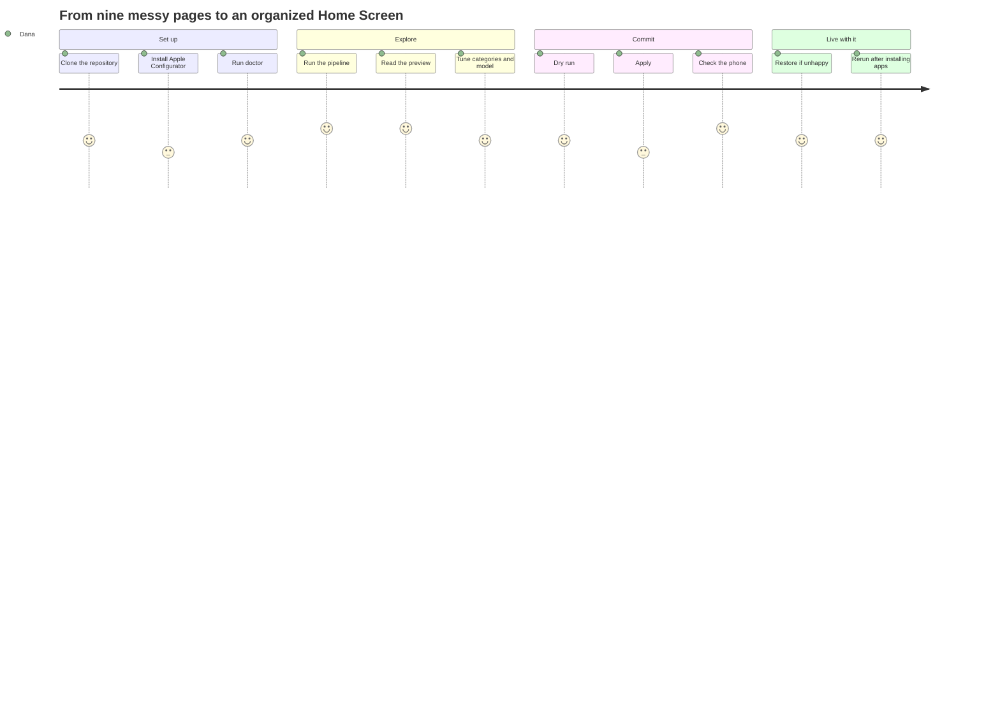

# User journey

The journey of Dana, the app collector from [personae.md](personae.md), from a cluttered phone to an organized one.

## Stage by stage

| Stage | What Dana does | What the tool does | What Dana is thinking | What could go wrong | How the tool helps |
| --- | --- | --- | --- | --- | --- |
| **1. Discover** | Reads the README | Explains the two schemes, the safety rules and the one network call | "Does this actually still work? Will it wreck my phone?" | Scepticism from past abandoned tools | Honest status section; "nothing changes until `apply`" stated up front |
| **2. Set up** | Clones, installs Apple Configurator, plugs in the phone, runs `doctor` | Checks `cfgutil`, the phone and local models | "What do I still need?" | Phone not trusted; Configurator window open | `doctor` names each missing piece and what to do |
| **3. First run** | Runs `run --open` | Scans, backs up, looks up genres, classifies, builds two proposals, opens the preview | "That was quick. Let's see." | Model not running; lookup fails | Falls back to rules and says so; continues without the lookup |
| **4. Review** | Compares the current layout with both proposals in the browser | Shows every page, folder contents, and how many icons move | "Folder board is closer to what I want, but the categories aren't mine." | Too many apps in "Other" | The summary shows the count; usage notes say how to improve it |
| **5. Tune** | Writes a taxonomy file, picks a larger model, reruns `classify`, `plan` and `preview` | Reuses the scan and cache; only redoes the changed steps | "Now it reads like my phone." | Category names too long for folder labels | Taxonomy guidance: keep names short |
| **6. Decide** | Runs `apply folder-board --dry-run` | Rereads the phone, validates the plan, reports the size of the change | "167 icons will move. OK." | Apps were installed since the scan | Refuses the stale plan and asks for a rerun |
| **7. Apply** | Runs `apply folder-board`, answers `y` | Saves a backup, writes the layout | "Moment of truth." | iOS ignores or partly applies the layout | Backup already saved; `restore` is one command |
| **8. Verify** | Picks up the phone and swipes through | Nothing | "Finally." or "Not quite." | A page reflowed around a widget | Documented limit; fix by hand or restore |
| **9. Undo (if needed)** | Runs `restore` | Writes back the layout from before the apply, after saving the current one | "Good, no harm done." | Backup predates newly installed apps | Warns about the mismatch and leaves the choice to Dana |
| **10. Maintain** | Months later, installs 15 apps and runs `run` again | Reuses the cache for known apps, classifies the new ones | "Two minutes, done." | None in particular | Same flow, faster |

## Moments that matter

1. **The first preview.** If the proposals look sensible, Dana keeps going. This is why classification quality and the preview page get the most attention.
2. **The confirmation prompt.** Trust depends on the tool never surprising her. The backup path printed just before the prompt is deliberate.
3. **The first restore.** A working undo turns a risky tool into a safe one to experiment with.

## Other journeys in brief

- **Priya** adds `--offline` at stage 3 and reads `classification.json` to see why each app landed where it did (each entry records its source).
- **Marcus** uses `--ecid` at every step, always does the dry run, and sticks to the built-in categories.
- **Elena** never plugs in a phone on stage: `bash scripts/demo.sh` covers stages 3 to 9 against the fake iPhone and leaves a preview page to show.
